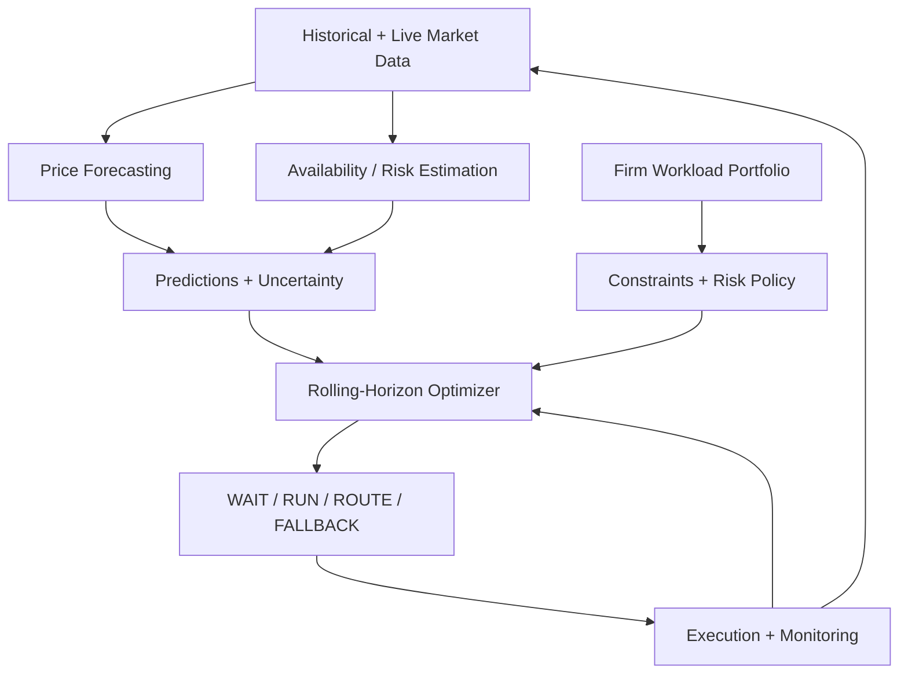

# AGENTS.md — Arbitr

## 1. Project Mission

Build an autonomous, buy-side compute arbitrage engine that purchases cloud compute on behalf of a firm.

The engine manages a portfolio of asynchronous workloads and decides when and where to execute them to minimize infrastructure costs while respecting deadlines, capacity constraints, hardware compatibility, and execution risk.

The system combines:

1. ML-based compute price forecasting
2. Availability and interruption-risk estimation
3. Rolling-horizon portfolio optimization
4. Autonomous workload execution and monitoring
5. Counterfactual replay and performance evaluation

The primary objective is cheap compute. Carbon optimization is secondary.

This is NOT a compute marketplace, financial exchange, brokerage, matching engine, or compute resale platform.

### Hackathon Goal

Deliver a compelling, functioning three-minute demo within 24 hours.

Prioritize:
- Real predictive modeling
- Correct constrained optimization
- Autonomous decision-making
- Fair, reproducible benchmarks
- At least one genuine local Docker execution
- A polished interactive trading terminal

Never fabricate benchmark results or claim simulated execution occurred on real cloud infrastructure.

---

## 2. System Architecture



### Technology Stack

- Backend: Python 3.11+, FastAPI, Pydantic
- ML: scikit-learn, LightGBM or XGBoost
- Optimization: Python, NumPy; OR-Tools if portfolio constraints require it
- Database: SQLite
- Frontend: Next.js, TypeScript, Tailwind, Recharts
- Execution: Docker SDK
- Testing: pytest
- Replay: Deterministic time-stepped simulator

Avoid unnecessary distributed infrastructure.

### Repository Layout

```text
frontend/
  app/
  components/
    Portfolio.tsx
    MarketChart.tsx
    JobBlotter.tsx
    DecisionInspector.tsx
    ReplayPanel.tsx
  lib/
    api.ts
    types.ts

backend/
  app/
    main.py
    api/
      schemas.py
    market/
      adapter.py
      features.py
    forecasting/
      price_model.py
      risk_model.py
      baselines.py
      evaluate.py
    engine/
      optimizer.py
      policies.py
      simulator.py
      reservations.py
    execution/
      docker.py
    jobs/
      store.py
    audit/
      events.py
  tests/

data/
  raw/
  processed/
  scenarios/
  provenance.md

models/
README.md
AGENTS.md
```

These are logical ownership boundaries. Preserve equivalent existing structures rather than performing unnecessary refactors.

---

## 3. Core Domain Contracts

All timestamps are UTC.

The MVP uses one-hour scheduling slots. Intervals are half-open: [startSlot, endSlot).

A job is deadline-feasible when endSlot <= deadlineSlot.

All API JSON fields use camelCase.

```typescript
type ResourceType = "CPU" | "GPU";

type JobStatus =
  | "PENDING"
  | "RUNNING"
  | "COMPLETED"
  | "FAILED"
  | "INFEASIBLE";

type Job = {
  id: string;
  name: string;
  arrivalSlot: number;
  durationSlots: number;
  deadlineSlot: number;
  resourceType: ResourceType;
  resourceUnits: number;
  gpuType?: string | null;
  allowedGpuTypes?: string[];
  allowedRegions: string[];
  maxBudgetUsd: number | null;
  priority: number;
  status: JobStatus;
  dockerTaskId: string | null;
};

type MarketSnapshot = {
  slot: number;
  region: string;
  resourceType: ResourceType;
  gpuType?: string;
  priceUsdPerUnitHour: number;
  availableUnits: number;
  carbonKgPerUnitHour: number | null;
  source: string;
  dataKind: "OBSERVED" | "FORECAST" | "SIMULATED";
};

type Forecast = {
  generatedAtSlot: number;
  targetSlot: number;
  region: string;
  resourceType: ResourceType;
  gpuType?: string;
  predictedPriceUsdPerUnitHour: number;
  priceLowerBound: number | null;
  priceUpperBound: number | null;
  availabilityProbability: number | null;
  interruptionProbability: number | null;
  modelVersion: string;
};

type Decision = {
  jobId: string;
  decidedAtSlot: number;
  action: "WAIT" | "RUN" | "ROUTE" | "FALLBACK" | "INFEASIBLE";
  region: string | null;
  plannedStartSlot: number | null;
  plannedEndSlot: number | null;
  projectedCostUsd: number | null;
  reasonCode: string;
  explanation: string;
  executionMode: "SIMULATED" | "PAPER" | "LOCAL";
};
```

These contracts must be agreed by all developers before independent implementation.

GPU job compatibility supports `allowedGpuTypes`: a list of alternative acceptable
models for one non-preemptive job, not a request for a mixed-model allocation.
`resourceUnits` GPUs of one acceptable model are required. Legacy `gpuType` jobs
remain valid and normalize to a singleton list. With several alternatives,
`gpuType` is null; CPU jobs have neither a GPU model nor alternatives. An empty
list with no `gpuType` preserves the legacy unrestricted GPU requirement, while
the Add job UI requires explicit model selection. The frontend/backend schemas
and API tests carry this additive field. Person 2 must use the list in optimizer
hardware checks rather than treating a null singular `gpuType` as unrestricted.


---

## 4. ML Forecasting Architecture

ML is a core subsystem, not merely an optional dashboard feature.

### Model 1: Compute Price Forecasting

Goal: Predict future GPU/CPU compute prices over a 1–6 hour horizon.

Recommended model:
- LightGBM or XGBoost regression
- Simple persistence forecast as baseline
- Optional rolling-average baseline

Potential input features:
- Recent spot prices
- Lagged prices
- Rolling price averages
- Historical volatility
- Region
- Instance/GPU type
- Hour of day
- Day of week
- Available capacity indicators, where available

Output:
- Predicted price for each region and future slot
- Uncertainty interval where properly estimated
- Forecast timestamp and model version

Do not assume electricity wholesale prices directly determine cloud GPU spot prices.

Weather features are experimental and should be retained only if they improve out-of-sample forecasting.

### Model 2: Availability and Interruption Risk

Goal: Estimate whether capacity will be available and whether workloads face interruption risk.

Potential inputs:
- Historical availability
- Capacity observations
- Previous interruptions
- Region and GPU type
- Recent market changes

Potential outputs:
- Probability of obtaining requested capacity
- Conditional probability of interruption during execution

IMPORTANT:

Do not train a supervised interruption classifier without actual historical interruption labels.

Historical spot prices alone are insufficient to establish interruption probabilities.

If labels are unavailable, implement an explicitly documented statistical or scenario-based risk model. Do not misrepresent it as trained ML.

### Forecast Evaluation

Use chronological train/validation/test splits.

Do not use randomly shuffled time-series splits.

Prevent:
- Future information leakage
- Rolling features using future observations
- Training on evaluation periods
- Retrospective forecasts using unavailable information

Price forecasting metrics:
- MAE
- RMSE
- Improvement over persistence baseline

Risk model metrics, only if genuine labels exist:
- Brier score
- Calibration
- Precision/recall where appropriate

Crucially, also evaluate whether improved forecasting actually reduces scheduling cost.

The scheduler must support both:
- ML forecasts
- Naive forecasts

This enables an ablation benchmark.

---

## 5. Rolling-Horizon Portfolio Optimizer

The optimizer is separate from the ML models.

It consumes forecasts and job constraints, then makes execution decisions.

### Required Inputs

- Current scheduling slot
- Pending jobs
- Running jobs
- Regional compute forecasts
- Risk estimates
- Current capacity
- Existing reservations
- Deadline constraints
- Budget constraints
- Startup/transfer overhead
- Configuration

### Required Outputs

For each pending job:
- WAIT
- RUN
- ROUTE
- FALLBACK
- INFEASIBLE

Also return:
- Selected region
- Planned execution window
- Expected cost
- Decision explanation
- Deadline slack
- Forecast/risk information used

### Optimization Objective

Minimize expected total firm expenditure:

Expected compute cost
+ expected interruption/recovery cost
+ startup and transfer costs
+ optional carbon valuation

Subject to:
- Job arrival constraints
- Hard deadline feasibility
- Regional capacity constraints
- Compatible compute hardware
- Per-job budget constraints
- Portfolio resource constraints
- Non-overlapping reservations
- Execution safety buffers

A probabilistic deadline constraint may be added only when risk probabilities are meaningfully calibrated.

### Portfolio Awareness

Never optimize jobs independently without accounting for shared regional capacity.

If a region has two available GPUs, the optimizer cannot allocate three simultaneous one-GPU jobs there.

Prioritize urgent workloads using deadline slack.

Use deterministic tie-breaking.

The MVP supports non-preemptive jobs.

Selecting another region before execution is ROUTE, not live migration.

### Rolling-Horizon Behaviour

At each scheduling tick:

1. Receive latest observed market information.
2. Generate updated price/risk forecasts.
3. Observe current running and pending jobs.
4. Recompute feasible allocations.
5. Choose execution actions.
6. Commit executions and reservations.
7. Monitor outcomes.
8. Repeat.

Running jobs must not be duplicated or arbitrarily migrated.

Near critical deadlines, prioritize execution reliability over speculative savings.

---

## 6. Execution and Monitoring

Implement a separate execution adapter.

MVP execution is local Docker.

Only allow predefined task IDs, images, and commands.

Do not allow arbitrary shell commands from frontend users.

Capture:
- Start time
- Completion time
- Exit code
- Standard output
- Standard error
- Failure reason

Label local execution as LOCAL.

A simulated route to Frankfurt followed by local Docker execution is not genuine Frankfurt cloud execution.

Do not provision paid cloud resources without explicit authorization.

Monitor:
- Job completion
- Execution failures
- Capacity changes
- Market observations
- Deadline risk

Monitoring must trigger forecast refreshes and replanning when relevant.

---

## 7. Replay and Benchmarking

Build a deterministic counterfactual replay system.

Supported strategies:

### FIFO

Starts eligible jobs as soon as compatible capacity becomes available, using a stable region-selection rule.

### CHEAPEST_NOW

Starts jobs without deliberately waiting for future prices and selects the lowest-priced currently feasible region.

### OPTIMIZER_WITH_NAIVE_FORECAST

Uses the same optimizer but a persistence or rolling-average forecast.

### OPTIMIZER_WITH_ML

Uses ML price forecasts plus the available risk estimates.

This fourth comparison is especially important: it tests whether ML creates real value.

### Fairness Requirements

All strategies receive identical:
- Job arrivals
- Resource requirements
- Deadlines
- Regional availability outcomes
- Realized market prices
- Simulated interruptions

Each strategy maintains independent job and capacity state.

Never give the optimizer actual future prices during historical replay.

The optimizer may only access predictions made using information available at its decision time.

Track:
- Total compute spend
- Completed jobs
- Missed deadlines
- Failed jobs
- Unfinished jobs
- Optional carbon estimates
- Recovery costs
- Savings against baselines

Never hide failed or unfinished jobs.

If two strategies complete different workloads, explicitly disclose that difference rather than claiming unconditional savings.

### Replay Events

Support:
- Price spikes
- Capacity shortages
- Spot interruption scenarios
- Deadline pressure
- New workload arrivals

Synthetic shocks must be clearly labeled SIMULATED.

Replay must be reproducible from a known seed.

---

## 8. Backend API

Required endpoints:

```text
GET  /api/health
GET  /api/jobs
POST /api/jobs
GET  /api/market
GET  /api/forecasts
POST /api/optimize
GET  /api/decisions

POST /api/replay/reset
POST /api/replay/step
GET  /api/replay/state
POST /api/replay/shock

GET  /api/metrics
GET  /api/models/metrics

POST /api/execute/{jobId}
```

FastAPI is the source of truth for:
- Scheduling decisions
- Forecasts
- Execution state
- Replay state
- Metrics

The frontend must not independently calculate official savings or scheduling results.

---

## 9. Frontend Requirements

Build a polished buy-side compute trading terminal.

Required sections:

1. Portfolio overview
2. Regional GPU price charts
3. Predicted price trajectories
4. Forecast uncertainty visualization
5. Workload blotter
6. Decision inspector
7. Live execution monitoring
8. Accelerated historical replay
9. Simulated market shocks
10. Policy comparison

### Current Frontend Design Specification

The accepted design is a calm, light-mode execution terminal called **Arbitr**.
Use the rules below as the source of truth for frontend styling and layout.
Prioritize clear hierarchy, focused views, and comfortable spacing.

1. **Unified brand and navigation.** Combine the Arbitr wordmark, task tabs, and
   data-source controls in one header. Use a prominent 36px, semibold wordmark on
   the left, tabs beside it, and controls on the right. Do not repeat the selected
   tab's title as a large heading below the header; use a short contextual sentence.
2. **Focused tabs.** Organize features into Overview, Workloads, Market, and
   Replay & execution. Overview contains portfolio metrics and upcoming workloads;
   Workloads contains the queue and selected execution plan; Market contains prices
   and forecasts; Replay & execution contains replay controls, execution monitoring,
   and policy comparison. Show only the active view's relevant content.
   In Add job, use separate Duration (hours) and Complete within (hours) inputs.
   The completion window includes waiting and execution from submission time;
   submit the existing arrival/deadline slot fields without requiring a UTC origin.
3. **Close tab underlines.** The active tab uses Blue Slate text and a 3px underline
   immediately beneath its label. Use approximately 6px vertical button padding.
   Center tabs within the header rather than stretching them to its full height;
   never leave a large gap between the label and its underline.
4. **Neutral light surfaces.** Use a neutral light-gray canvas (`#f6f6f6`), white
   panels (`#ffffff`), and subtle gray gridlines (`#dedede`). Backgrounds, table rows,
   and metric tiles remain neutral; do not tint them blue, green, or another accent
   hue. Keep square corners and flat borders, without decorative shadows/gradients.
5. **Blue-led palette.** Use the following colors consistently:

   - Jet Black `#2d3142`: headings, metric values, and primary body text.
   - Blue Slate `#4f5d75`: primary accents, navigation, controls, secondary text,
     keyboard focus, and historical chart lines.
   - Silver `#bfc0c0`: secondary borders and restrained details, not body text on white.
   - White `#ffffff`: panels and text on selected blue buttons.
   - Coral Glow `#ef8354`: secondary highlights and forecast lines, used sparingly.

   Use a darker coral (`#a54523`) for readable warning/error text on white. Pair
   statuses with explicit labels rather than relying on color alone. Selected
   buttons use Blue Slate fill with white text; tabs retain their underline style.
   Hover alone must not turn neutral controls blue. Inputs, dropdowns and boxed
   buttons gain a subtly thicker inset border on hover without layout movement.
   GPU/region selectors stay white, and native dropdowns match the form fields.
6. **IBM Plex Sans.** Use locally served IBM Plex Sans throughout the application,
   including controls, tables, charts, and tooltips. Load weights 400, 500, and 600
   through `@fontsource/ibm-plex-sans`. Use tabular numerals for aligned numerical
   data. Do not reintroduce monospace overrides.
7. **Breathing room.** Keep the main content centered at approximately 1400px maximum
   width, with 32px desktop side margins and 16px on smaller screens. Use 24px panel
   gaps, comfortable 12px/16px table-cell padding, and clear separation between
   header, context, and content. Avoid cramming every feature into one dashboard.
8. **Simple presentation.** Use clear text controls, straightforward panels and
   readable tables. Avoid generic icons, decorative illustrations, unnecessary
   wrappers, numbered panel labels, and repeated headings.
9. **Discrete charts and honest data.** Draw hourly scheduling data with step lines,
   never smooth curves. Label slot/price units and distinguish history, forecasts,
   and uncertainty ranges. Clearly label simulated/example data; never present
   sample forecasts, plans, savings, benchmarks, or execution as genuine results.
10. **Responsive and accessible.** On narrower screens, wrap tabs beneath the brand
    within the same header, stack panel columns, and allow tables/charts to scroll
    horizontally. Preserve visible keyboard focus, arrow-key/Home/End tab navigation,
    readable contrast, and explicit loading/empty/error states.

Keep theme tokens in `frontend/app/globals.css`. Preserve the accepted light theme,
IBM Plex Sans, tab structure, and spacing when adding features unless the user
requests a new direction.

### Demo Priorities

Make the optimizer explain its decisions.

For example:

"Waiting two hours is predicted to reduce GPU cost by 18%, while the job retains four hours of deadline slack."

When showing a predicted saving, distinguish it from a realized saving.

A judge should see:
- What the system predicts
- What action it chooses
- Why it chooses that action
- What actually happens
- How the outcome compares with a baseline

Do not build marketplace-style buyer/seller screens or fictional financial transactions.

---

## 10. Team Ownership

### Person 1 — ML Forecasting and Data

Own:
- backend/app/forecasting/**
- backend/app/market/features.py
- Model evaluation and tests

Responsibilities:
- Historical market data preparation
- Price prediction
- Naive forecasting baseline
- Risk estimation where data supports it
- Forecast uncertainty
- Chronological validation
- Model inference interface

Deliverable:
A forecasting service returning predictions and model provenance in the agreed schema.

### Person 2 — Optimization, Backend and Execution

Own:
- backend/app/engine/**
- backend/app/api/**
- backend/app/execution/**
- backend/app/main.py
- Backend integration

Responsibilities:
- Rolling-horizon optimizer
- Capacity reservations
- Portfolio constraints
- Replay policies
- FastAPI endpoints
- Docker execution
- Integration and correctness tests

Deliverable:
An operational decision and execution engine.

### Person 3 — Frontend and Demo

Own:
- frontend/**
- Demo presentation and UX

Responsibilities:
- Trading terminal
- Market visualizations
- Forecast displays
- Job blotter
- Replay controls
- Decision inspector
- Benchmark visualization
- Demo polish

Deliverable:
A complete frontend connected to backend endpoints.

Person 1 and Person 2 jointly own the integration of model outputs into scheduling.

Person 2 is the integration owner for shared backend files.

No developer should silently modify another developer's owned modules.

---

## 11. Development Milestones

### Hours 0–2 — Contracts and Scaffolding

All:
- Agree on API schemas
- Agree on scheduling units
- Freeze input/output contracts
- Prepare demo fixtures

Person 1:
- Investigate available historical data
- Define forecast interfaces

Person 2:
- Create backend schemas
- Implement initial optimizer interface

Person 3:
- Scaffold frontend and mock API client

### Hours 2–7 — First Working Intelligence

Person 1:
- Implement persistence baseline
- Train initial price forecasting model
- Produce forecast metrics

Person 2:
- Implement scheduling across regions and time slots
- Validate deadline and capacity constraints

Person 3:
- Build portfolio and price visualization
- Build decision interface

Milestone:
The scheduler makes feasible decisions using forecast input.

### Hours 7–11 — Forecasting and Replay Integration

Person 1:
- Improve and evaluate price forecasts
- Implement risk-estimation fallback

Person 2:
- Integrate forecasts
- Implement baseline policies
- Build deterministic replay

Person 3:
- Connect replay controls
- Visualize forecast versus realized prices

Milestone:
Replay compares naive-forecast and ML-forecast optimization.

### Hours 11–15 — Full Integration

Person 1:
- Validate prediction quality and leakage prevention

Person 2:
- Integrate Docker execution
- Add monitoring and shock handling

Person 3:
- Connect all backend APIs
- Add execution and decision inspection

Milestone:
Complete end-to-end demonstration works.

### Hours 15–19 — Feature Freeze

All:
- Validate accounting
- Test edge cases
- Fix integration problems
- Record honest benchmark results
- Improve demo reliability

Cut optional features if core functionality is unstable.

### Hours 19–24 — Final Demo

All:
- Rehearse presentation
- Verify clean reset
- Test simulated outage
- Verify real local execution
- Prepare backup recording
- Freeze code before judging

---

## 12. Engineering Rules

All coding agents MUST:

1. Read this file before making code changes.
2. Inspect existing code before proposing refactors.
3. Stay within assigned ownership boundaries.
4. Coordinate API or schema changes with the team.
5. Preserve teammates' uncommitted work.
6. Never force-push or destructively reset shared branches.
7. Write small, testable modules.
8. Keep forecasting independent from optimization.
9. Keep optimization independent from execution adapters.
10. Avoid future-data leakage in replay.
11. Use reproducible random seeds.
12. Label simulated data and outcomes honestly.
13. Do not invent benchmark results.
14. Run relevant tests before claiming success.
15. Report completed work, changed interfaces, test results, and outstanding issues.

Never silently change the project's objective from minimizing compute costs to minimizing carbon or building a marketplace.

---

## 13. Minimum Acceptance Criteria

- [ ] ML price forecasting model trained and evaluated against persistence
- [ ] Forecasts generated without future-data leakage
- [ ] Availability risk modeled honestly based on available evidence
- [ ] Portfolio optimizer enforces capacity, compatibility and deadlines
- [ ] Scheduler operates across multiple regions and execution windows
- [ ] Autonomous replanning responds to market changes
- [ ] FIFO, cheapest-now, naive-forecast and ML-forecast benchmarks implemented
- [ ] Replay is deterministic and fair
- [ ] Failed and unfinished jobs counted correctly
- [ ] Local Docker container executes successfully
- [ ] Frontend displays forecasts, decisions and outcomes
- [ ] Synthetic market shocks clearly labeled
- [ ] Three-minute demonstration works end-to-end

## 14. Core Product Pitch

"Cloud compute is a dynamic market, but most companies execute workloads without considering when or where capacity is cheapest.

We built an autonomous compute execution engine that forecasts future GPU prices, estimates execution risk, and schedules a firm's workloads across cloud regions to minimize cost while respecting deadlines.

It's a trading algorithm for buying compute, not an exchange for selling it."
